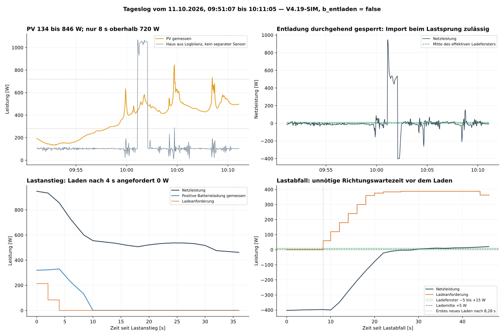
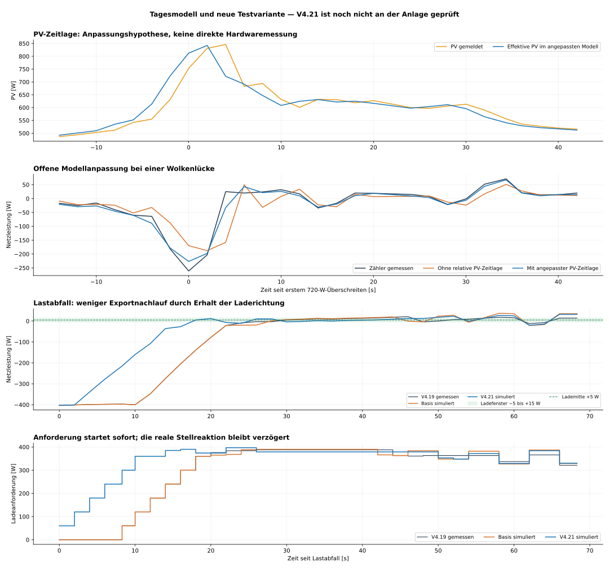

# V4.21-SIM: Tagesprüfung und gemeinsame Lade-Parameterauswahl

[English](README.md) | **Deutsch**

Das Tageslog vom 11.10.2026 enthält knapp 20 Minuten V4.19-SIM, PV 134 bis
846 W und durchgehend gesperrte Entladung. Alle 579 Ausgänge, Richtungen,
HOLD-Zustände, Parametersatznamen und Integratoren werden exakt reproduziert.
Alle Entladeanforderungen sind 0 W. Der große Lastimpuls wird nach Ladestopp
absichtlich durch das Netz gedeckt; dieser Import ist keine unerlaubte
Reglerabweichung, die durch eine Batterieentladung beseitigt werden soll.

Ohne den großen Lastimpuls liegt die mittlere Netzleistung bei −11,87 W,
die mittlere absolute Abweichung von der effektiven Lademitte bei 25,01 W.
Dieser Ausschnitt enthält laufende PV-Änderungen und ist kein stationärer
Nachtvergleich. Oberhalb 720 W gibt es nur vier Punkte beziehungsweise acht
Sekunden; oberhalb 1.050 W keinen Punkt.

**V4.21-SIM ist eine nächste Testvariante; ihr eigener Anlagentest steht aus.**
Die Basis ist V4.20-SIM. Die vorhandene Nachtänderung bleibt enthalten und
wird durch dieses Tageslog mit PV über 50 W nicht im Feld bestätigt.

## Änderungen

Die sieben Lade-Parameterzweige besitzen eine gemeinsame tabellarische
Auswahl; ihre P-/I-Zahlen, Statusnamen und PV-Fenster bleiben erhalten.
Die bereits identischen I-Parameter der drei Importzweige verwenden eine
gemeinsame Konfiguration. Eine Vereinheitlichung der Low-/Normal-PV-
Exportwerte wurde simuliert, zeigte aber keine durchgehende Verbesserung
und wurde nicht übernommen. High-/Very-High-PV-Regelwerte bleiben getrennt.

Die einzige neue Verhaltensänderung: Bei gesperrter Entladung, vorhandener
PV über 50 W und bereits aktiver Laderichtung bleibt der Regler im Laden/
Standby. Bei Hauslast über PV reduziert der unveränderte Ladezweig bis 0 W.
Ein nutzloser Wechsel in die gesperrte Entladerichtung wird vermieden.
Nach Lastabfall kann PV-Laden wieder am ersten verfügbaren Regeltakt
angefordert werden. Die Entladesperre wird nicht aufgehoben.

## Dateien

- [Vollständige Function-Datei](Regler_V4_21_SIM.js)
- [Bytegleiche Textdatei zum Einfügen](Regler_V4_21_SIM.txt)
- [Ausführliche Tagesanalyse](Regler_Tagesanalyse_DE.md)
- [Tagesmodell und Grenzen](Regler_Tagesmodell_V3.json)
- [Mess-/Simulationsergebnisse](Regler_Tag_Ergebnisse.json)
- [Änderungsumfang und Prüfumfang](Regler_Parameter.json)
- [Vorherige V4.20-Nachtvariante](../v4.20-sim/README_DE.md)

## Modell und Test

Die Ladetelemetrie besitzt einen anderen Offset als im Nachtbetrieb. Das
Tagesmodell berücksichtigt ihn, getrennte Netzwirkung und relative PV-
Messzeitlage. Die Hausleistung ist eine berechnete Bilanz, kein unabhängiger
Sensor. Die negative relative PV-Phase wird ausschließlich offline zur
Rekonstruktion verwendet; der Regler erhält keinen zukünftigen PV-Wert.
HTTP-/ACK-/Anwendungszeiten fehlen weiterhin.

Der nominale geschlossene Zählerverlauf besitzt 18,97 W RMSE und trifft die
Fensterzeit deutlich schlechter als der Nachtvergleich. Eine genaue neue
P-/I-Abstimmung ist damit nicht unabhängig validiert. In zehn Modellfällen
reduziert die Richtungsänderung MAE zum erlaubten stationären Ziel und
Exportenergie. Die Rückkehr ins Fenster wird jedoch in einem Fall langsamer:
36 statt 28 s. Importenergie kann bis 0,346 Wh, eine positive Nachlaufspitze
bis 20 W steigen. Die Änderung garantiert keine kleinere Spitze in jedem Fall.

Zehn Prüfgruppen bestehen. Die reine Parameter-Auswahl ist gegenüber der
Basis über alle vier Nachrichten in 1.687 Punkten der drei richtigen Logs
gleich. Zusätzlich bestehen 2.304 PV-/Fenster-Grenzkombinationen sowie
Energiespar-, SOC/OFF-, Snapshot-, Netzlade- und Ausgangsprüfungen.
Diese Grenzprüfungen sind keine Feldvalidierung starker PV-Erzeugung.

## In Node-RED prüfen

1. Bisherige Function sichern.
2. Vollständigen `.txt`- oder `.js`-Inhalt einsetzen; vier Ausgänge und
   bestehende Verdrahtung beibehalten.
3. Bei gesperrter Entladung denselben etwa 1-kW-Lastimpuls wiederholen.
   Alle Entladeanforderungen müssen weiterhin 0 W bleiben.
4. Nach Lastabfall Ladewiederaufnahme, Gegenspitzen und Import-/Exportenergie
   vergleichen. Netzbezug während des erlaubten Ladestillstands nicht als
   erforderliche Entladeleistung bewerten.
5. Längere Abschnitte ab 720 und 1.050 W sowie echte Befehls-/Antwortzeiten
   erfassen, bevor diese PV-Bereiche weiter abgestimmt werden.

Ein privates Reproduktionspaket enthält die drei richtigen Logs und die
Auswertungsskripte. Rohlogs und Anlagenexporte werden nicht öffentlich
hochgeladen. Reglerrevisionen sind unabhängig vom Wirkungsgrad-Release v5.1.0.
