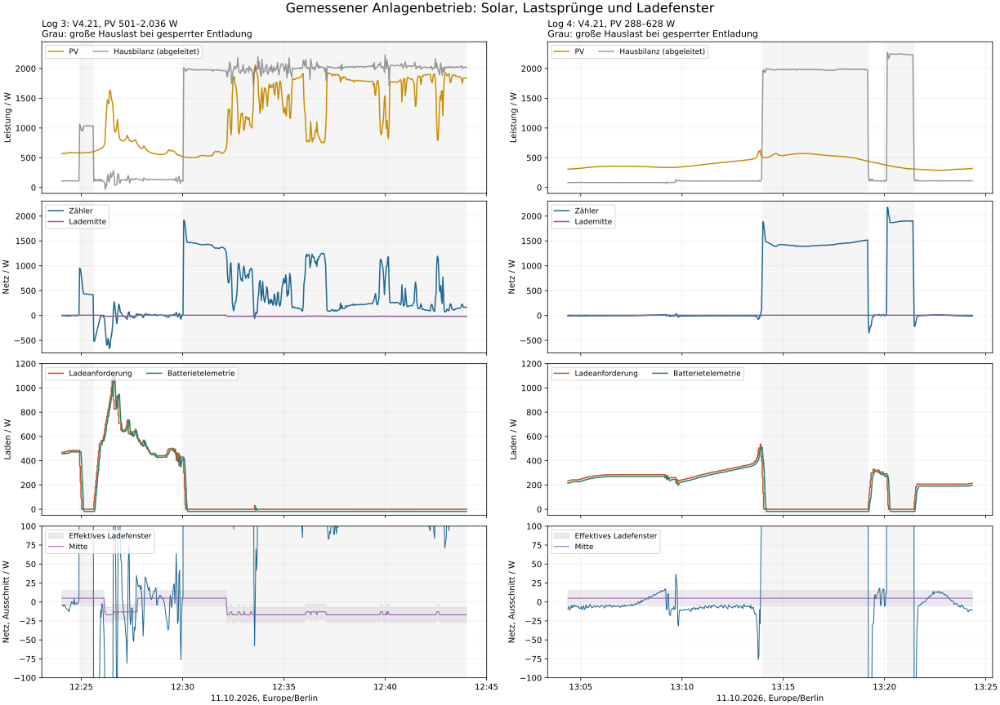
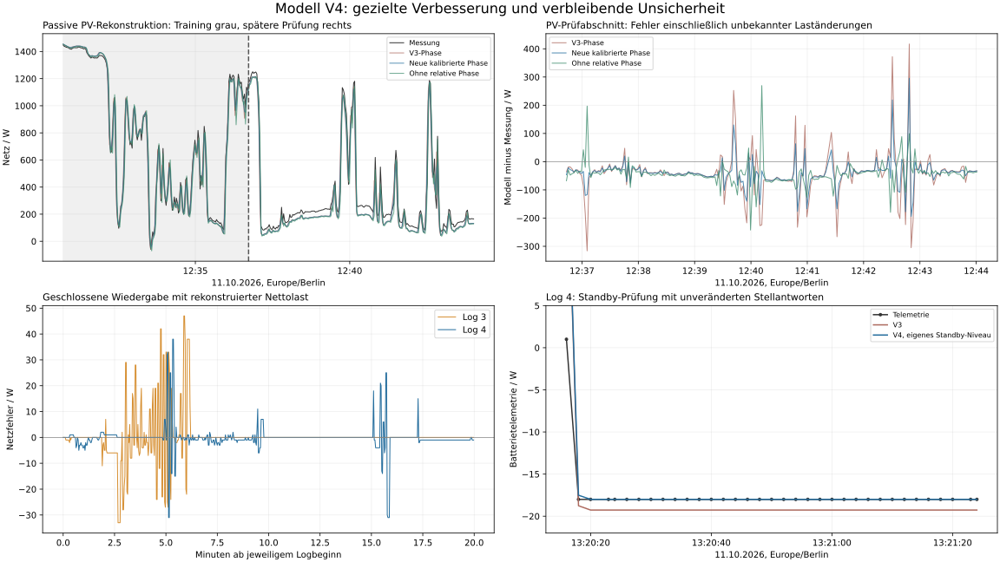

# V4.21-Feldvalidierung und Simulationsmodell V4

Stand: 11.10.2026. Grundlage: `regler_event_log_3.jsonl` und `regler_event_log_4.jsonl`; als vorheriger Tagesvergleich `regler_event_log_2.jsonl`. Das verworfene ursprüngliche falsche Log wird nicht verwendet.

## Ergebnis

**Die V4.21-Richtungskorrektur ist in den neuen Anlagenausschnitten bestätigt:** 1.188 Messpunkte, durchgehend gesperrte Entladung, 0 W Entladeanforderung und kein Richtungs-/AC-Mode-Wechsel. Bei allen drei beobachteten Lastabfällen beginnt Laden am ersten verfügbaren Regeltakt. Der zusätzliche Log prüft normale PV, der vorherige enthält schnelle PV bis 2.036 W. Das ist eine Feldvalidierung dieser Betriebsbedingung, keine vollständige Freigabe aller Betriebsarten.

**Die Simulation wurde an den neuen Daten verbessert, ohne den Reglercode zu ändern.** Warmstart/HOLD und Empfangszeit-Zuordnung sind korrigiert, Standby besitzt ein eigenes −18-W-Telemetrieniveau, und PV-Messzeitlage wird mit getrennten Kalibrier-/Prüfabschnitten untersucht. Die bisherige Stellantwort bleibt nominal erhalten: die gemeinsam neu angepassten dynamischen Varianten verbessern nicht beide Prüfungen. PV-Zeitlage und echte kleine Hauslaständerungen bleiben nicht eindeutig trennbar.

**V4.21 bleibt der eingesetzte Code. Es wird kein V4.22-Code ausgegeben.** Schnellere Lade-/PV-Rampen wurden nur in der Simulation geprüft; ihre Nachteile bei Gegenspitzen oder anderen Logs verhindern eine belastbare Übernahme. Die natürliche Tages-Optimierungsgrenze ist weiterhin nicht nachgewiesen.

## 1. Messumfang und gültige Daten

| Datensatz | Zeit Europe/Berlin | Punkte | PV | Tatsächlicher Regler |
|---|---|---:|---|---|
| Log 3 | 12:24:02–12:44:00 | 597 | 501–2.036 W | V4.21-SIM |
| Log 4 | 13:04:21–13:24:20 | 591 | 288–628 W | V4.21-SIM |
| Vorheriger Vergleich, Log 2 | 09:51:07–10:11:05 | 579 | 134–846 W | V4.19-SIM |

Jeder neue Log umfasst knapp 20 Minuten. Die Datenreihen werden wegen der Zeitlücken und verschiedenen Solarbedingungen nicht als lückenloser Tagesverlauf oder kontrollierter Vorher-/Nachher-Reglervergleich behandelt. Alle neuen Zeilen sind gültiges JSON. Regelung an, Netzladen aus, `b_entladen=false`, SOC-Minimum/-Maximum nicht aktiv. Alle Batteriemessungen sind für den Regler frisch.

Log 3 hat eine Lücke über 3 s, maximal 6,108 s; Log 4 neun, maximal 4,082 s. Es sind keine dazwischen liegenden Änderungen der letzten Ladeanforderung erkennbar. Median des vom Regler verwendeten Snapshot-Alters: 830 beziehungsweise 829 ms. Maximum: 1787 beziehungsweise 1793 ms; beide unter 1.800 ms.

**Die erste Zeile beider neuer Logs enthält einen veralteten zusätzlich angehängten `snapshot`.** CycleId und Werte passen dort nicht zu den frischen, tatsächlich verwendeten Regler-Eingängen. Sein äußeres Alter darf nicht als Regleralter interpretiert werden. Das neue Modell benutzt die passenden Empfangszeiten nur bei übereinstimmender CycleId und gleichen Eingangswerten. Für diese zwei ersten Zeilen wird die Zeit des vom Regler akzeptierten Snapshots verwendet. Die unbekannte Aufteilung auf die beiden Solarstrings wird dort nur offline aus dem nächsten passenden Split angenähert; alle Fits/Fehlerprüfungen der Batterie schließen die ersten fünf Punkte aus. Der Regler bekommt unverändert den geloggten aktuellen Gesamt-PV-Wert.

HTTP-/ACK-/Anwendungsdaten fehlen weiterhin: Eventlisten leer, Sequenzen 0, Werte null. Sollwerte sind deshalb keine bestätigten Hardware-Anwendungszeiten. `p_haus` ist weiterhin exakt PV + Zähler − Batterietelemetrie, kein unabhängiger Hauslastsensor.

## 2. Exakte Codewiedergabe und Feldvalidierung

Der vollständige Node-RED-Function-Inhalt wird mit den geloggten Eingängen ausgeführt. Über alle **1.767 Punkte** stimmen Lade-/Entlade- und Richtungsausgaben sowie Modus, HOLD, beide Integratoren, Parametersatz, Konfiguration, effektive Fenster und vollständiger PV-Guard überein. Der erste interne I-/HOLD-Zustand wird aus dem Anfangsdatensatz rekonstruiert; ein bereits bestätigter HOLD startet nicht künstlich bei Zähler 0. Bei den neuen Reihen berücksichtigt die Wiedergabe 125 beziehungsweise 117 interne Stellzeitstempel mit etwa 1 ms Abweichung vom Hauptzeitstempel.

Die V4.21-Datei ist bytegleich mit der bereits veröffentlichten Version. Die Tabellenzusammenfassung hat die ursprünglichen Parameterwerte erhalten. V4.21 enthält weiterhin die vorherige V4.20-Nachtänderung; mit PV stets über 50 W wird diese hier nicht im Feld geprüft. Freigegebene Entladung, Netzladen und SOC-Grenzen werden durch diese beiden neuen Logs ebenfalls nicht als Feldtest bestätigt.

## 3. Lastsprünge: gewollter Netzbezug und Wiederanlauf

Im Log 3:

- 12:24:54: Bilanzlast steigt um etwa 952 W bei unveränderter PV. Die Ladeanforderung fällt von 484 über 354, 224 und 94 auf 0 W nach sechs Sekunden. Positive Batterietelemetrie läuft weitere Sekunden aus.
- 12:25:36: Last fällt um etwa 927 W bei nur +3 W PV-Änderung. Bereits in diesem Punkt werden 60 W Laden angefordert. Erste Berührung des jeweils effektiven Fensters nach 24,0 s. Danach folgt der starke Solarimpuls; drei folgende Fensterpunkte erst nach 166,2 s sind keine reine Lastsprung-Ausregelzeit bei konstanten Bedingungen.
- 12:30:03: Bilanzlast steigt nochmals um etwa 1.908 W bei −3 W PV-Änderung. Die Entladesperre bleibt erhalten. Dieser Lastzustand endet innerhalb des Logs nicht; der verbleibende Import ist deshalb kein Beleg für einen unvollständigen Entladeregler.

Im Log 4:

- 13:13:57/59: gestufter Lastanstieg von etwa 882 und 956 W. Ladeanforderung 267 → 137 → 7 → 0 W. Danach rund 1,4–1,5 kW erlaubter Netzbezug bei nur ungefähr 0,5 kW Solar.
- 13:19:11/13: Last fällt in zwei Stufen. Schon beim ersten verfügbaren Überschuss werden 60 W Laden angefordert. Drei folgende Fensterpunkte nach **18,0 s**; niedrigster Zählerwert −347 W.
- 13:20:07: weiterer Lastanstieg um etwa 2.163 W, weiterhin 0 W Entladeanforderung. Die Ladeanforderung erreicht nach vier Sekunden 0 W.
- 13:21:26/28: Last fällt gestuft. Bei der noch zu hohen Teillast bleibt Laden 0 W; beim vollständigen Abfall beginnt es sofort mit 60 W. Drei folgende Fensterpunkte nach **12,0 s**; niedrigster Zählerwert −217 W.

Der Nutzlos-Wechsel in die gesperrte Entladerichtung und die anschließende zusätzliche rund 8-s-Richtungsbestätigung treten in keinem neuen Log auf. Die verbleibenden Startspitzen werden durch Mess-/Stellverzögerung und Aufwärtsrampe bestimmt. Die negative Standbytelemetrie um −18 W beweist keine angeforderte Hauslastentladung; alle Entladesollwerte bleiben 0 W. Messdefinition, Eigenbedarf und geringe reale Batterieleistung bleiben ungetrennt.

## 4. Solarhöhe und asymmetrische Fenster

| PV-Bereich | Ladefenster | Mitte | Neue Beobachtung |
|---|---|---:|---|
| unter 720 W | −5 bis +15 W | +5 W | gesamter Log 4; Normalanteil von Log 3 |
| 720 bis unter 1.050 W | −23 bis −3 W | −13 W | 87 Log-3-Punkte, davon 36 mit positiver Ladeanforderung |
| ab 1.050 W | −27 bis −7 W | −17 W | 315 Log-3-Punkte, davon nur 14 mit positiver Ladeanforderung |

Damit gibt es nun reale Very-High-PV-Daten, aber **fast alle liegen unter großer Hauslast im Ladestillstand**. Von den 14 Punkten mit positiver Ladeanforderung gehören 13 zum kurzen freien Solarimpuls; ein weiterer ist ein kurzer 30-W-Ladeversuch unter der langen Lastphase. Die vielen Standbypunkte ersetzen keinen längeren stationären Very-High-PV-Ladetest. Low-PV unter 280 W und Nachtoptimierung kommen in keinem neuen Log vor.

Im ersten Solarimpuls steigt PV von 862 auf 1.135/1.311/1.471 W. Der unbestätigte Very-High-PV-Guard lässt nur 30 W Ladeerhöhung pro Tick zu. Die Ladeanforderung steigt dort ungefähr 15 W/s, während Solar zeitweise deutlich mehr als 100 W/s zunimmt. Der Export erreicht **−665 W**. Später fällt Solar, die noch unterwegs befindliche Ladung erreicht 1.113 W Telemetrie und der Zähler **+277 W**. Diese Verlaufsform ist nicht allein durch eine P-Erhöhung zu lösen: die Aufwärtsbegrenzung und die verzögerte Stellantwort dominieren. Der Fall-Guard arbeitet, kann bereits unterwegs befindliche Stellleistung aber nicht rückwirkend zurückholen.

## 5. Gemessene Qualität ohne falsche Bestrafung der Entladesperre

| Bewertbarer Ladeabschnitt | Mittlerer Zähler | MAE zur jeweiligen Lademitte | Zeit im effektiven Fenster |
|---|---:|---:|---:|
| Log 4: erster Solarabschnitt | -4,53 W | 12,41 W | 38,02 % |
| Log 4: ohne große Lastphasen, mit Wiederanlauf | -8,04 W | 16,44 W | 46,65 % |
| Log 3: ohne große Lastphasen, mit schneller PV | -49,76 W | 78,38 W | 35,28 % |

Der erste Log-4-Solarabschnitt beschreibt 9 min 36 s mit 306–628 W PV und ohne große Lastphase. Seine negative Mitte gegenüber dem +5-W-Ziel bestätigt eine leichte Exportneigung. Die Wiederanlaufabschnitte erklären einen Teil der größeren Abweichung in der zweiten Zeile. Der schnell wechselnde Log 3 lässt sich damit nicht als Regler-Vorher-/Nachher-Vergleich bewerten.

Die globalen Mittelwerte +407,66 W beziehungsweise +497,20 W werden durch absichtlich ungedeckte Lasten dominiert. Sie sind keine sinnvolle P-/I-Zielfunktion. Log 4 besitzt 144 HOLD-Punkte mit 6,17 W mittlerer absoluter Mittenabweichung und 16,33 % Zeit in Mitte ±2 W. HOLD schützt weiterhin das gesamte 20-W-Fenster; eine enge Lade-Mittennachführung fehlt weiterhin.

## 6. Simulationsmodell V4: was übernommen wird

1. **Gültige Messzeit-Zuordnung und Warmstart.** Alte Logger-Snapshots werden nicht für aktuelle Regler-Eingänge verwendet. Bereits aktiver HOLD und der Anfangs-I-Zustand werden berücksichtigt. Zeitsprünge bleiben mit ihrer realen Dauer erhalten.
2. **Eigener Standbywert.** Bei Ladeanforderung 0 beschreibt Batterietelemetrie ein eigenes Niveau von −18 W. Es wurde aus 37 stationären Nullbefehls-Punkten des früheren Logs und des ersten Log-3-Abschnitts gelernt; Log 4 war daran nicht beteiligt. Bei positiver Ladeanforderung bleibt die bisherige affine Kennlinie mit Gain 1,01313 und Offset -19,27 W erhalten.
3. **Getrennte Zähler-/Batterieantwort mit FIFO.** Die bisherigen nominalen Ladeantworten bleiben erhalten. Die effektiven Batterie-Verzögerungen von 3,05/4,22 s sind Modellwerte, keine durch ACK verifizierten Hardware-Totzeiten. Eine affine gemeinsame Neuanpassung verschlechtert den späteren dynamischen Log-3-Test von 15,15 auf 18,10 W RMSE; sie wird nur als Unsicherheitsfall behalten.
4. **PV-Messzeitlage mit Prüfung.** Die neue relative Summen-PV-Phase beträgt ungefähr -0,93 s. Ihre Kalibrierung erfolgt bei Null-Ladebefehlen in Log-3-Punkten 200–379, unter Ausschluss des kurzen 30-W-Versuchs und seiner Nachlaufpunkte. Punkte 380–596 prüfen die spätere Übertragung. Eine Variante ohne Phase bleibt ausdrücklich erhalten. Separate String-Phasen verbessern den Trainingsfit, sind wegen korrelierter Signale und kaum bestimmbarer kurzer Zeitkonstanten nicht eindeutig identifiziert und werden nicht zur alleinigen nominalen Wahrheit erklärt.
5. **Richtige Zielbewertung.** Jeweils effektive asymmetrische Fenster gelten auch für die Rückkehrzeit bei wechselnder PV-Klasse. Für gesperrte Entladung wird die Mitte auf den mit Laden 0…2.400 W erreichbaren stationären Netzbereich projiziert. Der erlaubte Import bei fehlendem Überschuss wird nicht als erforderliche Batterieentladung optimiert.

Die negative PV-Phase rekonstruiert ausschließlich offline unterschiedliche interne Messzeitlagen. Die Regelcodeausführung verwendet nur den zum jeweiligen Punkt gemeldeten Gesamt-PV-Wert. Es wird kein zukünftiger PV-Wert in den Regler eingespeist. Zeitlage, Filter, Gerätewirkungsgrad und echte kleine Hauslaständerungen können mit der Bilanzhausgröße nicht vollständig auseinandergehalten werden.

## 7. Getrennte Kalibrierung und Prüfung

### Batterie: offene Wiedergabe mit tatsächlich geloggten Ladebefehlen

| Prüfung | V3: RMSE / MAE | V4: RMSE / MAE |
|---|---:|---:|
| Log 3, gesamte neue Reihe ohne erste 5 Punkte | 7,99 W / 3,51 W | 7,90 W / 2,60 W |
| Log 3, spätere dynamische Prüfung 100–185 | 15,15 W / 7,84 W | 15,15 W / 7,84 W |
| Log 4, unabhängiger Log ohne erste 5 Punkte | 4,43 W / 1,62 W | 4,36 W / 1,22 W |
| Log 4, aktive Ladung und Auslauf | 5,27 W / 1,78 W | 5,26 W / 1,77 W |
| Log 4, stationärer Standby | 1,28 W / 1,27 W | 0,08 W / 0,01 W |

Die deutliche Standbyverbesserung ist real im Messmodell, **keine verbesserte Regelung oder neue Genauigkeit der gesamten Anlage auf Hundertstelwatt**. Die Daten sind in ganzen Watt quantisiert. Die dynamische Prüfung bleibt unverändert, und einzelne offene Modellfehler reichen weiterhin bis rund 72 W im schnellen Log 3 beziehungsweise 49 W in Log 4.

### PV-Rekonstruktion bei Null-Ladebefehlen in Log 3

| Variante | Training-RMSE, 173 Punkte | Späterer RMSE, 217 Punkte | Späterer MAE |
|---|---:|---:|---:|
| Bisherige relative Phase | 50,18 W | 87,81 W | 61,33 W |
| Neue kalibrierte relative Phase | 31,01 W | 62,32 W | 49,79 W |
| Ohne relative Phase | 66,85 W | 59,86 W | 50,14 W |

Für jede Variante wird nur der Grundlast-Intercept aus demselben Trainingsabschnitt angepasst. Im späteren Abschnitt bleibt er fest. Die neue Phase überträgt sich deutlich besser als die alte −1,52-s-Phase; **die Null-Phasen-Variante besitzt jedoch den kleineren späteren RMSE**. Es gibt deshalb keinen gesicherten einzelnen optimalen PV-Zeitparameter. Diese Fehler enthalten auch unbekannte reale Laständerungen der ungefähr 2-kW-Last. Das Modell führt die Alternativen als Unsicherheit und erfindet keine exakte Hauslastkurve.

### Geschlossene Wiedergabe

Mit unverändertem V4.21 erreicht das nominale Modell in Log 3 8,72 W Zähler-RMSE, in Log 4 5,44 W. In Log 4 beträgt die Batterietelemetrie-MAE geschlossen 2,34 W; die erste Lastabfall-Fensterfolge wird wie gemessen nach 18,0 s erreicht.

**Diese geschlossene Wiedergabe ist kein unabhängiger Nachweis einer vollständigen Solar-/Hauslast-Vorhersage.** Ihre äußere Nettolast wird als gemessener Zähler minus modellierter Netzwirkung der tatsächlich geloggten Ladeanforderung rekonstruiert und für alle Parameter-/Unsicherheitsfälle festgehalten. Restliche PV-/Hauslastschwankungen werden somit als äußerer Verlauf wiederverwendet. Bei Log 3 bestehen weitere Abweichungen bei den schmalen Fenstern; der gute globale RMSE wird teilweise durch den langen Ladestillstand begünstigt.

## 8. Parameterdiagnostik: schnellere Rampen sind kein kostenloser Gewinn

Zwei begrenzte Varianten wurden gegen denselben V4.21-Code unter fünf Modellfällen je Log geprüft: nominal, Verzögerung −0,4/+0,5 s und die beiden alternativen Batteriedynamiken. Die Reglerdatei wurde dabei nicht verändert. Positive Werte in der Tabelle sind Verschlechterungen gegenüber dem unveränderten Code.

| Nur simulierte Änderung | Schlechteste MAE-Änderung Log 2 | Log 3 | Log 4 | Größte höhere positive Gegenspitze |
|---|---:|---:|---:|---:|
| Unbestätigte PV-Schritte 60/45 statt 45/30 W | 0,93 W | -0,32 W | 0,00 W | +105 W |
| Lade-Aufwärtsrampe 90 statt 60 W | 7,54 W | -0,25 W | 4,62 W | +34 W |

Die höheren unbestätigten PV-Schritte verbessern im schnellen Log 3 die MAE, können dort aber eine zusätzliche positive Spitze von bis zu 105 W erzeugen. Die 90-W-Aufwärtsrampe verbessert diesen schnellen Log ebenfalls, verschlechtert aber den früheren und den ruhigeren Log. Beide Varianten werden deshalb nicht als neuer Regler ausgeliefert. Die begrenzten Versuche beweisen nicht, dass keine bessere dynamische Strategie möglich ist; sie widerlegen eine pauschale Erhöhung als robuste Verbesserung.

Die frühere Zusammenlegung identischer Import-I-Werte und der tabellarischen Parameterauswahl bleibt im Feld nachvollziehbar. Verschiedene High-/Very-High-PV-P-/I-Werte und Fensterverschiebungen bleiben getrennt. Die Daten enthalten noch zu wenig anhaltendes freies High-/Very-High-PV-Laden, um sie gefahrlos durch einen gemeinsamen neu abgestimmten Satz zu ersetzen.

## 9. Optimierungsgrenze und nächster Datengewinn

Die Entladesperre ist eine feste Betriebsstrategie-Grenze. Nach Ladestopp ist der verbleibende Netzbedarf hier gewollt. Dagegen ist die Tages-Mittenregelung noch nicht an einer belegten natürlichen Grenze: das Lade-HOLD hält das ganze Fenster, das ruhige Mittel liegt etwas zu exportseitig, und freiwillige PV-/Laderampen bestimmen große Solarabweichungen.

Messzeitlage, Stellverzögerung und schnell wechselnde Solarleistung setzen echte Grenzen. Aus der ruhigen Nachtqualität darf kein identisches Tagesversprechen abgeleitet werden. Für weitere Abstimmung ist der wichtigste Datengewinn die bestätigte Befehls-/ACK-/Anwendungszeit; außerdem längere Ladestrecken oberhalb 720 und 1.050 W bei kleiner Hauslast. Die vorhandenen knapp 26 freien Very-High-PV-Sekunden reichen für einen stationären Parametersatz nicht aus.

V4.21 kann für die weitere Beobachtung beibehalten werden. Ein neuer Function-Inhalt ist für dieses Modellupdate nicht erforderlich. Die gespeicherten Kandidaten sind Diagnoseversuche und keine automatisch empfohlenen Anlagenparameter.

## 10. Reproduktion und Dateien

- `Regler_Modell_V4.json`: nominale Werte, Kalibrier-/Prüfumfang, alternative Fits und Grenzen.
- `Regler_V4_21_Validierung_Ergebnisse.json`: Messwerte als Aggregate, Modellprüfungen und Parameterdiagnostik; keine Rohlogs.
- `Regler_Simulation_V4_Paket.zip`: privates Paket mit den drei richtigen Tageslogs, den vollständigen Regler-Basisdateien und Python-/JavaScript-Auswertung. `python reproduce.py` verwendet gespeicherte Fits; `--fit` kalibriert die deklarierten Abschnitte neu. Kein Gerätezugriff und keine Veröffentlichung aus dem Paket.
- **8 Prüfgruppen bestanden**, 1767 Code-Vergleichspunkte, 30 geschlossene Wiedergaben und 45 Parameterdiagnosefälle. Python und JavaScript stimmen bei 591 ungerundeten Batteriewerten überein. Ausgangsgrenzen, Entladesperre, Snapshot-Zuordnung und unveränderter Code sind geprüft.

Anlagenlogs bleiben privat. Die Veröffentlichung enthält nur Analyse, Modell, aggregierte Ergebnisse und Abbildungen. Die Reglerrevision ist unabhängig vom Wirkungsgrad-Release v5.1.0.

SHA-256 V4.21-Code: `2d1863b93df594604811a0b9c2a9eed2d250a671db452418dad061fce35069bc`.

SHA-256 Log 3: `8aa66faa960199498ea84321c8f6ca048ec8d0da314b4073853cf9d37607f8ca`.

SHA-256 Log 4: `8816b495282f55377ea087d99fed005feb9ff91ec52a0693066b9f34ebd1c8fe`.
