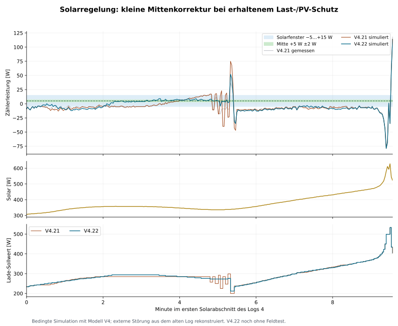

# V4.22-SIM: Solar-Mittennachführung und BLE-Diagnose

[English](README.md) | **Deutsch**

Experimentelle Testversion des separaten PI-Reglers. Kein Feldtest dieser Revision und kein Deploy an eine Anlage. Die Wirkungsgrad-Releaseversion bleibt v5.1.0.

V4.21 hält beim Laden nach zwei Punkten irgendwo im Solarfenster. V4.22 führt unter ruhigen und frischen Bedingungen mit höchstens 3 W je mindestens 6 s zur **Mitte des aktuell effektiven** Fensters nach. Bei den bisherigen −5…+15-W-Einstellungen sind die Ziele +5 W (PV <720 W), −13 W (720…<1050 W) und −17 W (ab 1050 W). Die Funktionen verwenden die aktuellen Grenzen. Nachtführung, P/I, große Rampen, PV-Guards und Entladesperren bleiben erhalten.

[Vollständiger Regler](Regler_V4_22_SIM.js) · [Text zum Einfügen](Regler_V4_22_SIM.txt) · [Ausführliche Analyse](Solar_BLE_V4_22_Analyse.md) · [Modell](Regler_Modell_V4_BLE.json) · [Ergebnisse](Regler_V4_22_Ergebnisse.json)



## Einbau

Den gesamten Text im bestehenden Regler-Function-Node ersetzen. Vier Ausgänge und bestehenden Flow-Kontext beibehalten. `chargeCenterTrimEnabled=false` deaktiviert ausschließlich die neue Solar-Feinführung. Der Controller funktioniert ohne die neue Transportdiagnose; ein fehlender Snapshot-Diagnoseblock bleibt dann sichtbar fehlend und verändert nicht die Regelung.

Die generischen Diagnosefunktionen sind hier veröffentlicht. Den gelieferten anlagenspezifischen Einbauplan und die neuen Nodes privat verwenden; reale Anlagenexporte gehören nicht in dieses Repository. Der gewöhnliche JSON-Import regulärer Nodes ist keine zugesagte In-place-Aktualisierung. Für vorhandene Function-Nodes Texte ersetzen und Diagnose-Durchleitungen bewusst einfügen.

- [Messwerte_berechnen_BLE.js](Messwerte_berechnen_BLE.js): bestehender Snapshot-Builder mit zusätzlicher Diagnosekopie; **11 Ausgänge**. Die eigentliche anlagenspezifische Messanbindung bleibt extern.
- [Zusatzdaten_BLE.js](Zusatzdaten_BLE.js): bisheriger Zusatzlogger ohne HTTP-Felder, mit `batteryBle` und geprüftem Snapshot; **1 Ausgang**.
- `BLE_Audit_inputLimit.js`, `BLE_Audit_outputLimit.js`, `BLE_Audit_acMode.js`: nach dem jeweiligen RBE/Umschaltknoten direkt vor den vorhandenen HA-Steuernode schalten. Je **1 Durchleitungsausgang**; direkte alte Verbindung ersetzen.
- `BLE_Audit_HA_Abschluss.js`: Ausgänge der drei HA-Steuernodes. `BLE_Audit_HA_Fehler.js`: Catch ausschließlich für diese drei Nodes. Diese Funktionen senden keine Steuernachrichten.
- `BLE_Bereitschaft_Diagnose.js`: nach beiden bestehenden Ready-Change-Nodes; nur bei Ready=true an die bisherigen ESP-Abfragen weiterleiten. Bei Current-State zusätzlich `msg.data=entity` ausgeben.
- `inputLimit_Ruecklesewert.js`, `outputLimit_Ruecklesewert.js`: eigene HA-Current-State-Abfragen der **bereits vorhandenen** Input-/Output-number-Entities, mit `msg.payload=entityState` und `msg.data=entity`. Keine abgeleiteten Entity-IDs raten.

SOC/Pack/AC-/Battery-Observer für den persönlichen Flow liegen im privaten Einbaupaket; ihre Geräteidentitäten sind hier nicht veröffentlicht. Diagnose ausschließlich am ungedrosselten Regler-Ausgang 4 vor dem bestehenden JSONL-Logger erfassen. Den im Status gelieferten Snapshot später nicht überschreiben.

## Aussagekraft

8 synthetische Tests und zusätzlich 1.767 Tages-/1.108 Nacht-Eingabepunkte wurden geprüft. Bei deaktivierter Solarergänzung bleibt der bisherige Regelkern erhalten; die aktive Solarergänzung verändert den Nachtkern nicht. 108 bedingte Simulationen prüfen drei Tageslogs, sechs Streckenmodelle und sechs Varianten. Die gewählte Variante verbessert die MAE auf allen 18 Log-/Modellkombinationen; beim schnellen PV-Verlauf ist der Vorteil teilweise klein. Höchste positive Peak-Zunahme: 4 W auf Log 2, 0 W auf Log 3, 2 W auf Log 4. Eine zusätzliche Nachführung während laufender kleiner Sollwertänderungen wurde wegen schlechterer Übertragbarkeit und bis zu 21 W zusätzlicher Importspitze verworfen.

Die Teilzeiten des BLE-Pfads wurden ohne neue gemessene Transportzeiten nicht neu gefittet. Ein erfolgreicher HA-Aufruf ist kein BLE-Schreib-ACK. HA-number-Zustände des untersuchten BLE-Controllers sind Geräte-Rücklesewerte; Zeitfolge und Wertgleichheit sind keine Message-ID-Korrelation. Die natürliche Optimierungsgrenze und Überschwingfreiheit bei beliebiger Sonne sind nicht nachgewiesen.

```sh
node --test regulator/experimental/v4.22-sim/tests/*.test.cjs
```

Die acht synthetischen Tests laufen auch in der bestehenden Node-22/24- und UTC/Berlin-CI-Matrix. Die privaten Feldlogs werden nicht eingecheckt.
