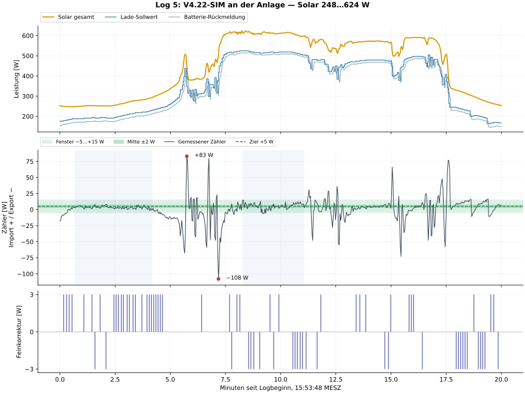
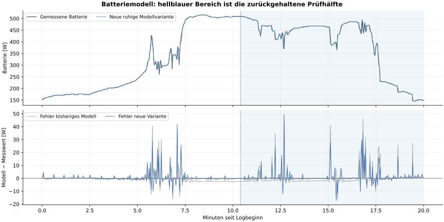

# Log 5: Feldprüfung V4.22 und kleine Wartungsfassung V4.23-SIM

Der neue Log bestätigt die Solar-Mittenführung von **V4.22-SIM**. Ruhige Abschnitte treffen die effektive Mitte von +5 W gut. Bei wechselnder Solarleistung bleibt eine größere dynamische Abweichung; größere Feinschritte verbessern diese nicht verlässlich. **P/I und Rampen bleiben unverändert.** V4.23 ergänzt ausschließlich 2 ms Toleranz am Solar-Feinregelungszeitpunkt und sichtbare BLE-Diagnoseabdeckung. V4.23 ist eine geprüfte Testfassung, noch kein neuer Feldtest.

## Messung und gültiger Bewertungsbereich

583 Datensätze vom **11.10.2026, 15:53:48–16:13:47 MESZ**, Dauer 19 min 59 s. Ausschließlich `REGEL_LADEN`, Geräte-AC-Modus 1, Solar 248…624 W. Das wirksame Fenster ist durchgehend **−5…+15 W**, seine Mitte **+5 W**. Der Log enthält keine High-/Very-High-PV-Phase. Deren Mittelpunkte −13/−17 W bleiben wie zuvor erhalten und werden synthetisch getestet, hier jedoch nicht neu an der Anlage validiert.

`b_entladen=true` gilt durchgehend, Netzladen ist aus, keine SOC-Sperre. In den vorherigen Lastsprunglogs war die Entladung gesperrt. Dieser Log zeigt weiterhin ausschließlich Laden und keinen Entlade-Richtungswechsel. Er enthält **keinen großen, unabhängig belegten Hauslastsprung**. Die daraus abgeleitete Hausleistung liegt zwischen 38 und 171 W, ist aber `Solar + Zähler − Batterie` und kein separater Hauszähler. Kurze Ausschläge dürfen deshalb nicht eindeutig einem eingeschalteten Verbraucher zugeordnet werden.

## Gemessene Regelgüte

Alle Werte sind mit der tatsächlichen Zeit bis zum nächsten Datensatz gewichtet; der letzte Punkt hat keine künstlich verlängerte Dauer. Ruhige Ausschnitte sind beschreibende Abschnitte desselben Logs, keine zusätzlichen unabhängigen Testläufe.

| Abschnitt | Dauer | Zähler-Mittel | Mittlere absolute Abweichung von +5 W | Im Fenster | In Mitte ±2 W |
| --- | ---: | ---: | ---: | ---: | ---: |
| Gesamter Log | 1199,38 s | 0,91 W | 10,61 W | 69,46 % | 32,24 % |
| Ruhiger Abschnitt, ca. 15:54:29–15:57:59 | 209,84 s | 3,54 W | 2,04 W | 100,00 % | 69,41 % |
| Solarplateau, ca. 16:02:05–16:04:51 | 166,08 s | 5,40 W | 3,53 W | 95,18 % | 43,94 % |

Gesamtmittel **+0,91 W** bedeutet leichten absoluten Import. Gegenüber dem Ziel +5 W liegt es **4,09 W auf der Exportseite der Mitte**. Es wäre daher falsch, den Regler als vollständig zentriert oder als absoluten Dauerausführer zu bezeichnen. Importenergie 1,99 Wh, Exportenergie 1,69 Wh. Die kurze Beobachtung ersetzt keine Tagesenergiebilanz.

71 Feinkorrekturen, davon 42 × +3 W und 29 × −3 W. Insgesamt 194 geänderte Lade-Sollwerte mit 2683 W aufsummierter absoluter Änderung. 167 Datensätze melden bestätigte Solar-Mitte. Weitere 63 melden den ursprünglichen Fenster-HOLD, während die feinere Stabilitätsfreigabe noch fehlt. Beim ständigen Solartrend kann die 6-s-Wartezeit durch reguläre Sollwertänderungen neu beginnen; das ist der beabsichtigte Vorrang der schnellen Regelung.

## Spitzen und Zuordnung

Der größte Import ist **+83 W um 15:59:33**, der größte Export **−108 W um 16:00:59**. Beide gehören zur schnellen Regelung, nicht zu einer gleichzeitig angewandten 3-W-Feinkorrektur. Um die Importspitze fällt die Solarleistung 498→448 W, während die Batterie-Rückmeldung noch 426 W beträgt. Der Lade-Sollwert fällt bereits 438→396→348 W. Um die Exportspitze folgen eine größere Ladeabsenkung und ein Solaranstieg; die Zähler-/Batteriewerte reagieren versetzt. Die abgeleitete Hausleistung zeigt dabei kurze Gegenimpulse. Ein exakter physikalischer Anteil von Last, Sensorphase und Stellverzögerung ist mit diesen Kanälen nicht identifizierbar.

Die langsame Mittenführung hilft bei eingeschwungenen Messwerten. Sie kann nicht jeden Solarwechsel im Zwei-Sekunden-Raster ohne Spitze kompensieren. Der reale Zähler überschreitet das Fenster weiterhin; **Überschwingen ist nicht vollständig beseitigt**.

## Parameterbewertung und Simulationsvergleich

Normal-PV: P beim Import 1,02, beim Export 1,00; Low-PV-Export 0,93. Import-I 0,0014 mit Begrenzung 2 W; Export-I 0,0076 mit 13 W, Low-PV-I 0,007 mit 12 W. Die gemeinsame HOLD-Abnahme bleibt 0,86. Feinführung verwendet keinen zusätzlichen I-Beitrag, behält aber die native Integratorbehandlung. Die asymmetrische I-Begrenzung bleibt bewusst erhalten: Der neue Log belegt keinen Vorteil einer Änderung. Ihre Werte sind keine kontinuierlichen Sekunden-Zeitkonstanten, sondern werden pro Regleraufruf angewandt.

Laderampen bleiben +60/−130 W pro Zyklus bei Normal-PV, mit bisherigen High-PV-Schutzwerten. Feinführung bleibt **±3 W**, Zielband **±2 W**, 3 stabile Messzyklen und Batterienachführung innerhalb 35 W. PV-, SOC-, Richtung-, Snapshot- und Entladesperren bleiben erhalten.

Verglichen wurden vier gültige Tageslogs, acht Anlagenvarianten und neun Reglerfälle, also **288 unterschiedliche Läufe**, zusätzlich **32 Fälle** für die 2-ms-Zeittoleranz. Modellvarianten umfassen die bisherige Anlage, Verzögerungsabweichungen −0,4/+0,5/+1,5 s, frühere alternative Batteriefits und zwei neue Kalibrierungen. Die früheren großen, wegen Entladesperre unvermeidbaren Importintervalle werden aus der regulären Mittenkennzahl ausgeschlossen; sie bleiben in den vollständigen Simulationen erhalten.

| Versuch | Befund gegenüber V4.22 | Entscheidung |
| --- | --- | --- |
| Feinschritt 4 W | In Log 4 mehr Mittennähe, aber eine Importspitze bis +13 W höher; Log 5 teils MAE +3,56 W | Verworfen |
| Feinschritt 2 W | In Log 5 in allen Modellen schlechter, bis MAE +3,85 W | Verworfen |
| 8 s Wartezeit | Log 5 bis MAE +3,69 W; frühere Importspitze bis +49 W höher | Verworfen |
| Freigabe bei Zählerdelta 8 statt 6 W | Kleine Vorteile im neuen Log, Verschlechterungen in früheren Logs | Verworfen |
| 5/5,8/5,9 s Wartezeit | Nur geringe Vorteile, nicht übertragbar | Keine Verkürzung des nominalen 6-s-Werts |
| 2 ms Zeittoleranz | Repariert ein belegtes Rasterproblem; untersuchte Gesamtextrema unverändert | Übernommen als Wartung, kein behaupteter Gütesprung |

Für Log 5 ist V4.22 gegenüber V4.21 in allen acht Modellfällen besser: mittlere absolute Zielabweichung um **0,70…5,42 W** geringer. Das ist eine **bedingte Simulation**, kein gleichzeitig gemessener A/B-Vergleich. Der vorhandene Feldlog wurde nur mit V4.22 aufgenommen. Selbst die nominale V4.22-Simulation weicht vom gemessenen Zähler um RMSE 15,03 W ab; mit der neuen ruhigen Variante sind es 9,02 W. Kleine Kandidatendifferenzen dürfen nicht als präzise reale Verbesserung ausgegeben werden.

## Angepasstes Simulationsmodell V5

Das Modell erhält seine getrennten FIFO-verzögerten, richtungsabhängigen und begrenzten PT1-Antworten für Netzbeitrag und Batterie-Rückmeldung. Die Netzantwort ist nicht identisch mit dem Batterie-Sensor. Kalibriert wurde zusätzlich die ruhige Batterieantwort an **Log-5-Index 5…299**. **Index 300…582** wurde dafür nicht verwendet.

Die neue ruhige Variante hat effektive Batterieverzögerungen von etwa **3,04 s aufwärts / 3,07 s abwärts**, statt bisher 3,05/4,22 s. Ihr gemeldeter stationärer Wert ist ungefähr `1,0203 × Lade-Soll − 20,79 W`; der Standby-Telemetriewert bleibt −18 W. **Das ist kein AC/DC-Wirkungsgradmodell und keine bewiesene interne BLE-Latenz.**

| Zurückgehaltener Batterie-Prüfabschnitt | Bisherige RMSE | Neue ruhige Variante RMSE | Bewertung |
| --- | ---: | ---: | --- |
| Log 5, zweite Hälfte | 7,55 W | 6,16 W | Verbesserung um ca. 18 %; MAE 3,57→2,25 W |
| Log 3, dynamischer Abschnitt 100…185 | 15,15 W | 11,60 W | Verbesserung |
| Log 4, Abschnitt 285…590 mit großen Sprüngen | 5,66 W | 6,66 W | Verschlechterung |

Deshalb ersetzt die neue Variante das bisherige übertragbare Modell **nicht pauschal**. V5 nimmt sie ausdrücklich als zusätzlichen Betriebs-/Unsicherheitsfall auf. Ein nur statisch angepasster Gain/Offset sowie ein auf kleinen Absenkschritten basierendes komplexeres Modell verbesserten nicht alle zurückgehaltenen RMSE-Werte; zusätzliche Fallunterscheidungen wurden verworfen.

Der externe Netto-Störverlauf wird offline aus gemessenem Zähler minus bisher modelliertem Lade-Netzbeitrag rekonstruiert und für alle Kandidaten festgehalten. Er enthält reale Last-/Solaränderungen sowie verbleibende Messphasenfehler. Er wird nicht aus der abgeleiteten Hauslast als unabhängiges neues Messsignal behandelt. Damit lassen sich alternative Parameter bedingt untersuchen; unbekannte Solar-/Hausverläufe werden nicht vorausgesagt. Mehrere Modelle und unveränderte Schutzlogik sind erforderlich. Weder Netz-/PV-Verzögerung noch Batterieentladung oder 2400-W-Betrieb werden durch diesen Log neu identifiziert.

## Diagnosebefund und Anpassung

**Keiner der 583 Datensätze enthält `batteryBle`; alle enthalten alte, leere HTTP-Diagnose.** Die neue Reglerfunktion wurde eingesetzt, die BLE-Diagnose kommt im ausgewerteten Logpfad noch nicht an. Das kann durch noch nicht ersetzte Funktionen oder einen weiterhin verwendeten alten Loggerpfad entstehen; die genaue Verdrahtung ist im Log nicht sichtbar.

Alle 583 Regler-Statusmarker melden den im Regler eingefrorenen Diagnosesnapshot als fehlend. Der alte nachgelagerte Logger fügt dennoch einen Snapshot hinzu. 582 dieser externen Objekte passen offline zu Messwerten und Zyklus; der erste ist rund 2 h 29 min alt und wird verworfen. Für ihn werden nur Status-Eingänge und der tatsächlich bestätigte Snapshot-Zeitpunkt verwendet. Die Regel-Snapshot-Prüfung ist durchgehend frisch, Alter 572…1792 ms, Median 827 ms. Fehlende Diagnose ist somit nicht gleichbedeutend mit fehlenden Regelmesswerten.

V4.23-Diagnose markiert acht erwartete Beobachter, fehlende/ungültige Einträge, alte Poll-Zeitpunkte und den eingefrorenen Snapshot ausdrücklich. Unbekannte Werte bleiben null. HA-Aufruf, HA-Abschluss und echter Geräte-Rücklesewert bleiben getrennt; ein HA-Abschluss wird weiterhin **nicht** zum BLE-Schreib-ACK erklärt. Ein unveränderter HA-State kann alt sein, ohne dass BLE gestört ist. Alte HTTP-Felder werden entfernt. Keine automatische Wiederholung über RBE oder neue Anlage-Ansteuerung wurde hinzugefügt.

## Kleine Änderung in V4.23

Im Feld bleibt eine fällige Feinkorrektur dreimal bei Alter **5999 ms** aus; der nächste Regleraufruf kommt ungefähr zwei Sekunden später. V4.23 behält `waitMs=6000` und erlaubt **2 ms Zeitrastertoleranz**, somit frühestens 5998 ms. Schritte und alle Freigaben bleiben gleich. Die untersuchten Gesamtextrema ändern sich in keinem der 32 Fälle. Die MAE ändert sich in Log 5 um −0,03…−0,26 W; in Log 4 kann sie um +0,17 W steigen. Diese Größen sind kleiner als der Modellfehler und rechtfertigen keine Aussage über einen realen Gütesprung. Die Änderung behebt den belegten Timing-Effekt.

Alle 583 V4.22-Feldzyklen wurden mit identischen Leistungswünschen, Richtung, HOLD, Parametersatz, Integrator und Fenstern exakt reproduziert. Bei abgeschalteter 2-ms-Toleranz bleibt der Regelkern über **3458 aufgezeichnete Eingangszyklen** identisch. Mit aktiver Änderung bleibt der Nachtkern über **1108 Eingangszyklen** identisch. Der neue vollständige Function-Text reproduziert die getestete Timing-Variante in allen 32 Simulationen. Zehn synthetische Regressionstests prüfen Mitten aller PV-Fenster, Schutzfälle, langsamere Anlage, Zeitraster und Diagnosequalität. Die 103-Node-Referenz erhält sämtliche bestehenden Leitungen.

## Ist die natürliche Optimierungsgrenze erreicht?

**Für ruhige Solarabschnitte ist V4.22 bereits nahe am Ziel; eine allgemeine natürliche Grenze ist nicht nachgewiesen.** Integer-Watt-Werte, zwei Sekunden Reglerabstand, mehrere Sekunden Mess-/Stellreaktion und wechselnde PV erklären einen erheblichen Teil der verbleibenden Abweichung. Der Wechsel zwischen Sollwertbasis und gemeldeter Batterieleistung, tatsächliche Befehlsübernahme sowie Sensorphasen sind noch nicht unabhängig aufgelöst. Größere P/I-/Rampenwerte sind mit dieser Modellgenauigkeit nicht belastbar optimierbar. Bei stark wechselnder Solarleistung bleibt möglicher Spielraum, für dessen Beurteilung die BLE-Rücklesewerte gebraucht werden.

## Nächster Anlagentest

Den bestehenden vierausgängigen Regler durch den vollständigen Text `Regler_V4_23_SIM.txt` ersetzen. Die Diagnose gemäß **NodeRED_BLE_V4_23_Einbau.md** im tatsächlich verwendeten ungedrosselten Logpfad einsetzen. Der Messwerte-Builder muss `snapshot_last_diagnostic` bereitstellen; Zusatzdaten muss `batteryBle` Schema 1.1 liefern; danach darf kein älterer Logger Snapshot/HTTP-Diagnose erneut überschreiben. Den Flow-Referenzausschnitt nicht zusätzlich als zweiten Regler betreiben.

Vor einer längeren Aufnahme einen Datensatz auf `batteryBle`, `diagnosticCoverage.allObserversPresent=true` und `snapshotAttachment.matched=true` prüfen. Bei einer Sollwertänderung müssen `ha_call_requested` und anschließend Abschluss/Fehler vorkommen; während unverändertem HOLD sind keine neuen Aufrufe erforderlich. Danach 20 Minuten mit Solarplateau, Solarwechsel und einem getrennt nachvollziehbaren Verbraucher aufnehmen. Bei günstigen Strompreisen bleibt die Entladesperre maßgebend. Dieser Arbeitsgang hat nichts zur laufenden Anlage übertragen.

### Reproduzierbarkeit und Quellenbindung

Log-SHA256: `fe35ce9e5805ca3463b550361475d597b5a006d81b62a5bad73520cf688f1553`. Validierter V4.22-Function-SHA256: `7bdcd6123f7faba80144088a2f4140193d529f3d29f9d5f03eb384c0bda0d1f7`. Neuer V4.23-SHA256: `2637493cba5c6fa77a666128f129229a5ae23aaea482957e9784c7af3627748d`. Der verworfene falsche erste Log wurde nicht verwendet. Rohlogs, Geräteidentitäten und persönliche Anlagenexports werden nicht veröffentlicht. Vollständiger Code, V5-Modell und die aggregierten Ergebnisse liegen im GitHub-Verzeichnis `regulator/experimental/v4.23-sim`.
