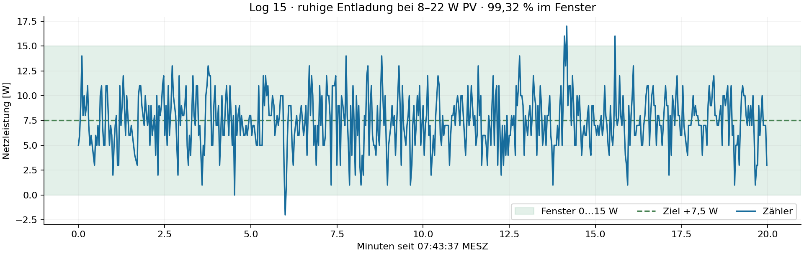
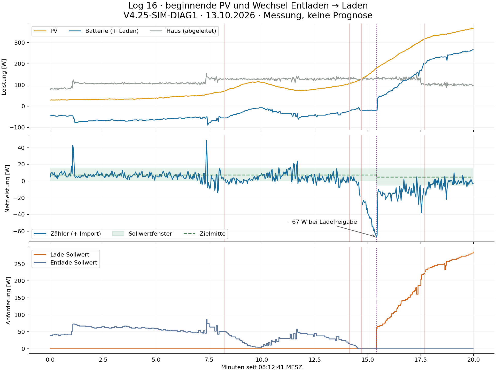

# Log 15/16: Tagesanlauf, Diagnose und Modell V14

Stand: 13.10.2026. **Regler bleibt V4.25-SIM-DIAG1. Modell wird V14.** Keine der sechs untersuchten Änderungen bietet unter den betrachteten Modellunsicherheiten eine durchgängig bessere Kombination aus Fenstertreue, Importspitze und ruhiger Richtungswahl. Deshalb wird keine V4.26 als neuer Anlagenstand ausgegeben. Das physikalische Optimum ist **nicht** nachgewiesen: Besonders der Übergang und die ansteigende PV lassen noch Regelreserve erkennen.

## Gemessene Regelqualität

Positiver Zählerwert bedeutet Import, negativer Export. Das Entladefenster ist **0…+15 W**, Ziel **+7,5 W**. Das Ladefenster ist **−5…+15 W**, Ziel **+5 W**. Diese Asymmetrie wird in allen Auswertungen berücksichtigt. Zeiten zwischen fehlenden oder verworfenen Messzyklen werden nicht als 0 W gezählt und nicht für Energiekennzahlen überbrückt.

| Abschnitt | PV | Mittlerer Zähler | Mittlere absolute Zielabweichung | Zeit im jeweiligen Fenster |
|---|---:|---:|---:|---:|
| Log 15, ruhige Entladung | 8–22 W | +7,47 W | 2,17 W | 99,32 % |
| Log 16, Entladung bis 50 W PV | 29–50 W | +7,18 W | 2,39 W | 98,11 % |
| Log 16, PV über 50 W, Entlade-Sollwert > 0 | über 50 W | +3,74 W | 6,02 W | 74,47 % |
| Log 16, Laden unter 280 W PV | 180–279 W | −16,27 W | 21,27 W | 4,00 % |
| Log 16, Laden ab 280 W PV | 280–367 W | −5,16 W | 10,35 W | 67,66 % |
| Log 16, letzte 120 s Laden | innerhalb obigem Bereich | −2,03 W | 7,31 W | 85,59 % |

Log 15 trifft die Mitte sehr gut. Die Entladung bis 50 W PV bestätigt dieses Verhalten auch in Log 16. Bei steigender PV oberhalb davon wandert die Lage zur Exportseite. Die besondere Entlade-Mittennachführung ist im bestehenden Code nur bis 50 W PV freigegeben; oberhalb greifen andere Regelzweige. Das ist ein konkreter Ansatz für weitere Optimierung, kein Nachweis eines reinen Anlagenlimits.

Log 16 enthält **29–367 W PV**, also weder High-PV ab 720 W noch Very-High-PV ab 1.050 W. Zuverlässige Importvermeidung in diesen Klassen wird durch diese Logs nicht neu validiert. Keine Fensterverschiebung wird eingeführt.

## Übergang Entladen → Laden

Der Entlade-Sollwert erreicht am 13.10. um **08:27:13,930 MESZ** null. Laden wird erst um **08:28:06,074** angefordert: **52,144 s später**, bei **−67 W Zählerleistung**, **180 W PV** und **60 W Ladeanforderung**. Positive Batterieleistung erscheint zwei Messzyklen später. Rund 3,2 s zwischen Anforderung und Batterie-Empfangszeit passen zur bisherigen Ladeverzögerung; es wird kein zusätzlicher pauschaler 8-s-Anlauf angesetzt. Der bisher dokumentierte volle Standby → Entladen ist ein anderer Betriebsfall.

Die intern bestätigte Laderichtung wird in 18 gültigen Aufrufen vom Richtungsschutz blockiert. Dieser fordert gleichzeitig:

- Zählerexport stärker als 35 W;
- PV mehr als 40 W über der abgeleiteten Hausleistung;
- gemessene Entladung unter 220 W.

Trotz Entlade-Sollwert null meldet die Batterie überwiegend **−19 W**. Da `Haus = PV + Zähler − Batterie`, wird die zweite Bedingung dann rechnerisch zu **Zähler < −59 W**. Sie ist also strenger als die erste. Danach kommen die bestehenden Richtungsbestätigungen hinzu. Das erklärt den späten Beginn, ohne einen Fehler im BLE-Befehlspfad vorauszusetzen.

**−19 W sind ein Telemetrie-Betriebspunkt.** Ohne unabhängige Haus-/AC-Leistungsmessung lässt sich daraus nicht sicher auf reale Dauerentladung schließen. Modell V14 unterscheidet daher gemeldeten Leerlauf und mögliche physikalische Leerlaufbeiträge.

Beim anschließenden PV-Anstieg bleibt die Ladeleistung hinter der Zielmitte zurück. Die 3-W-Mittenkorrektur ist nur bei ausreichender Stabilität und abgeschlossener Stellreaktion zugelassen. Größere Trimmschritte allein beheben den Verlauf kaum, weil dieser Zweig während des Anstiegs nur selten freigegeben wird. Ein stärkerer globaler Gain wäre aus diesem Log ebenfalls nicht belastbar begründbar.

## Diagnose tatsächlich live bestätigt

| Prüfung | Log 15 | Log 16 |
|---|---:|---:|
| Gültige JSONL-Zeilen | 594 | 599 |
| Regelberechnungen | 594 | 594 |
| Dokumentierte Snapshot-Abbrüche | alte Diagnose: nicht enthalten | 5 |
| Fehlende Zyklusnummern | 5 | 0 |
| Fehlerhafte Zuordnung eines ausgeführten Snapshots | 0 | 0 |
| HA-Anforderungen / zugeordnete Abschlüsse | 135 / 135 | 192 / 192 |

In Log 16 bleiben bei allen fünf Abbrüchen die Regelausgänge 1–3 leer, Ausgang 4 enthält Diagnose. Drei Abbrüche gehen auf Builder-Latenzen von **694, 546 und 512 ms** bei einer 450-ms-Grenze zurück. Der Empfangsversatz zwischen den Messwerten war nur **16, 1 und 1 ms**. Zwei weitere Aufrufe hatten bereits akzeptierte Snapshots desselben Zyklus, aber ein Alter von **1.871 bzw. 1.843 ms** bei der Reglergrenze von 1.800 ms. Die Aufrufabstände waren dabei gut drei Sekunden; der Regler selbst benötigte höchstens 5 ms.

Das spricht bei diesen Ereignissen für verspätete Verarbeitung, nicht für stark gegeneinander versetzte Messwerte. Eine Lockerung kann sinnvoll untersucht werden, ist hier aber **nicht vorgenommen**: Bei Builder-Ablehnungen fehlen die verworfenen Messwerte, sodass die Folgen einer nachträglichen Zulassung nicht vollständig simuliert werden können. Die neue Diagnose arbeitet pro tatsächlich eintreffendem Trigger; sie ist kein eigener Timer und beseitigt keine Verzögerungen im vorgelagerten Flow.

Lade- und Entladesperren sind getrennt enthalten. In diesen beiden Logs ist keine der beiden Sperren aktiv. Das bestätigt die getrennte Ausgabe, nicht die gesamte Wahrheitstabelle bei realen Sperrwechseln. Logger-V2-Sequenzen sind durchgehend, die Snapshots passen zum jeweiligen ausgeführten Zyklus. Werte aus ergänzenden Logger-Feldern dürfen bei Diagnose-only-Zeilen nicht als neue 0-W-Messung interpretiert werden; maßgeblich sind `execution.controlExecuted` und die null gesetzten Regler-Eingänge.

## Kalibrierung des Modells

V14 übernimmt die vorhandenen Modelle für Aufnahmebegrenzung und vollen Standby unverändert. Neu kommen der schwache Tagesanlauf, der Telemetrie-Leerlauf um −19 W, die explizite Behandlung bekannter Diagnose-Abbrüche und ein gekoppeltes, vorzeichenbehaftetes Anlagenmodell für den Richtungswechsel hinzu. Ladeverzögerungen beziehen sich auf den Regleraufruf; Entladeverzögerungen auf die HA-Anforderung. Die zusätzliche HA-Latenz wird nicht doppelt addiert. Zähler und Batterie werden an ihren jeweiligen Empfangszeiten abgetastet.

Die Entlade-Korrektur wurde nur an den ersten zehn Minuten von Log 15 angepasst und am Rest sowie an Log 16 geprüft. Die Lade-Korrektur wurde nur an den ersten 120 s Laden angepasst und am verbleibenden Abschnitt geprüft.

| Unabhängiger Prüfabschnitt | Bisheriges Modell RMSE / MAE | Neu angepasster Offset RMSE / MAE |
|---|---:|---:|
| Log 15, letzte zehn Minuten | 2,07 / 1,62 W | 2,41 / 1,45 W |
| Log 16, aktive Entladung | 2,93 / 1,27 W | 2,80 / 0,78 W |
| Log 16, späteres Laden | 1,89 / 1,20 W | 1,65 / 1,35 W |

Die neu angepassten aktiven Offsets verbessern nicht beide Fehlermaße in allen vorgesehenen Prüfabschnitten. **Die bisherigen aktiven Modellparameter bleiben deshalb Standard**; neue Offsets werden nur als Unsicherheitsvarianten untersucht. Die Leerlaufanpassung reduziert dort den Fehler von etwa 16 W auf unter 0,4 W, wurde aber am selben Leerlaufereignis angepasst und ist keine unabhängige Validierung.

## Geschlossene Simulation und Entscheidung

**1.001 Simulationsläufe:** sieben Reglerfassungen einschließlich unveränderter Basis, jeweils 52 logbasierte und 91 synthetische Szenarien. Es läuft der vollständige Function-Code. Stellbefehle verändern die modellierte Anlage und damit die nächsten Regler-Eingänge. Die AC-Richtungsrückmeldung folgt der simulierten Richtung mit Verzögerung, nicht unverändert der aufgezeichneten Umschaltung.

Untersucht wurden Verzögerungsfaktoren 0,8/1/1,25, bisherige/lokal angepasste aktive Offsets, physikalischer Leerlauf −19/0 W, verzögerte Richtungsrückmeldung und alternativ fehlende Ladeaufnahme unter 60 W Anforderung. Letzteres ist bewusst eine Unsicherheit: Der Log misst aktive Ladeanforderungen erst ab 60 W, maximal 285 W. Die Logfälle werden mit und ohne wiederverwendeten Batterie-Messrest gerechnet. Synthetische Fälle enthalten konstante Last, PV-Anstieg, kurze Wolken, Lastsprung, Grenzpendeln und einen frühen PV-Einbruch kurz nach möglicher Ladefreigabe.

| Versuch | Vorteil | Gegenbefund / Entscheidung |
|---|---|---|
| Entlade-Mittennachführung bis 280 W PV | Etwas höhere Fenstertreue | In Log-Sensitivitäten bis etwa 9,1 W höhere Importspitze; unverändert lassen |
| Überschussreserve 40 → 25 W, nur unter 280 W PV, Entlade-Sollwert 0, frische Batterie und ≤30 W gemeldete Entladung | Nominal Log 16 rund 10 s frühere Freigabe, rund 0,16 Wh weniger Export | Frühe Wolke: bis 30,38 W höhere Importspitze und zwei zusätzliche Richtungswechsel; nicht übernehmen |
| Lade-Trimmschritt 3 → 5 bzw. 6 W, nur unter 280 W PV | Teilweise schnellere Mitte | Kaum Wirkung im aufgezeichneten Anstieg; synthetisch bis 6,08 / 9,12 W höhere Importspitze und einzelne schlechtere Zielabweichungen; nicht übernehmen |
| Kombinationen | Teilweise bessere mittlere Zielabweichung | Übernehmen die genannten Nachteile; nicht übernehmen |

Im nominal nachgebildeten Log reduziert die 25-W-Reserve die stärkste Exportabweichung von −67 auf −59 W. Der positive Eindruck reicht nicht: Bei angenommener fehlender Aufnahme kleiner Ladeanforderungen entstehen im Ladeabschnitt zusätzliche Ausschläge; im frühen Wolkenszenario steigt die Importspitze beispielsweise von 90 auf 120,38 W. Dies sind **Simulationsergebnisse, keine beobachteten Anlagenfehler und keine Eintrittswahrscheinlichkeiten**.

Der äußere Nettoleistungsverlauf ist aus dem Originalversuch rekonstruiert; insbesondere bei wiederverwendetem Messrest ist die genaue Baseline-Wiedergabe ein Konsistenztest, kein Beleg für Vorhersagegüte. Ohne unabhängige Lastmessung und weitere Umschaltungen sind physikalischer Leerlauf, Messoffset und Laständerung nicht eindeutig identifizierbar. Sieben gezielte Simulatorprüfungen prüfen Kausalität, Vorzeichen, Leerlauftrennung, Kandidatenwirkung und Baseline-Konsistenz. Ein separates Regler-Replay reproduziert alle **1.188 ausgeführten Entscheidungen** ohne Abweichung. Log 15 wird an fünf unbekannten Lücken neu initialisiert; Log 16 behält seinen Zustand über die fünf dokumentierten Abbrüche hinweg. Im Replay werden die protokollierten internen Trim-Zeitpunkte verwendet, um Millisekunden an der 6-s-Grenze korrekt wiederzugeben; in der Simulation läuft eine virtuelle Uhr.

## Nächster sinnvoller Anlagenversuch

Den vorhandenen **V4.25-SIM-DIAG1 weiterlaufen lassen**; kein Node-Tausch für dieses Modellupdate. Besonders wertvoll ist ein weiterer natürlicher Entladen→Laden→Entladen-Verlauf bei etwa 100–300 W PV, aufnahmefähiger Batterie und kleinen PV-/Lastschwankungen. Er sollte die ersten Ladeanforderungen und tatsächliche Aufnahme eng erfassen. Eine unabhängige Hausleistungsmessung würde Leerlauf und Telemetrieoffset trennen. Falls später gezielt Ladeanforderungen unter 60 W getestet werden, ist das ein eigener beaufsichtigter Anlagenversuch, nicht eine hier bereits validierte Regleränderung.

Ein physikalisches Gesamtoptimum ist nicht erreicht bzw. nicht belegt. Bei ruhiger geringer PV trifft die vorhandene Regelung die Mitte bereits sehr gut. Beim Übergang besteht Optimierungspotenzial, aber der nächste belastbare Fortschritt benötigt zusätzliche Information über das Verhalten bei kleinen Ladeleistungen und wechselnder PV.
