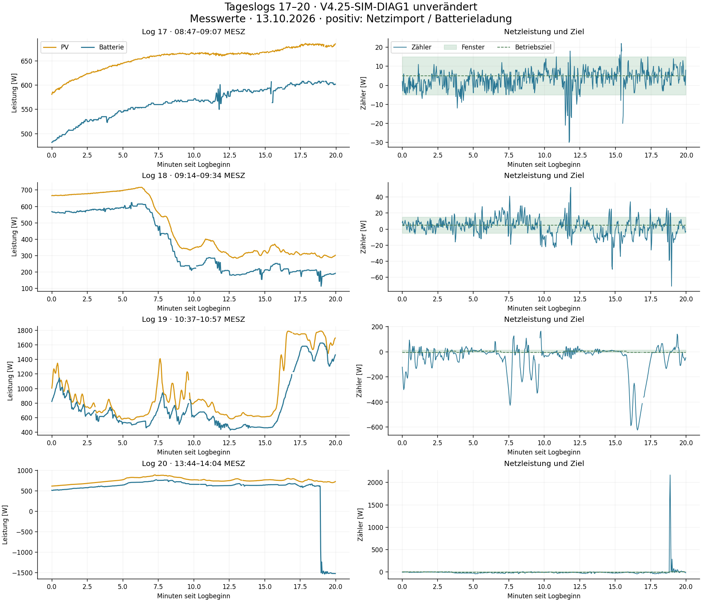
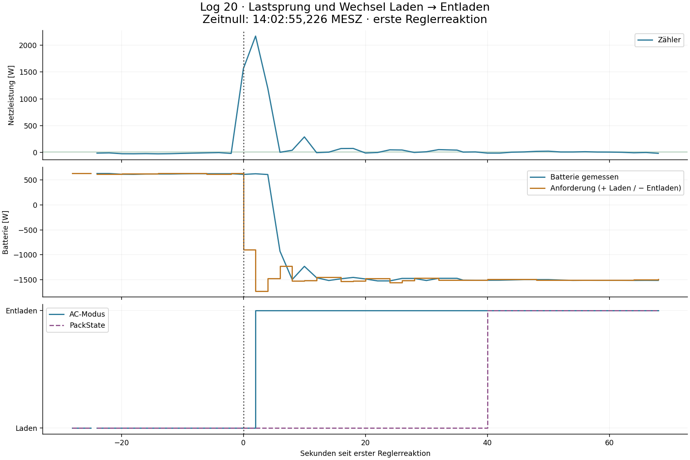

# Tageslogs 17–20: Feintuning und Modell V15

Stand 13.10.2026. **Modell V15 wird ergänzt; Regler V4.25-SIM-DIAG1 bleibt unverändert.** Die vier Tageslogs wurden vollständig ausgewertet. 15 Regleränderungen wurden in 1.920 geschlossenen Simulationen untersucht; drei aussichtsreiche Varianten und die Basis anschließend in 520 weiteren Fällen geprüft. Keine Änderung wird als neuer Anlagenstand empfohlen: Der Export lässt sich reduzieren, aber die Priorität „bei hoher PV möglichst zuverlässig keinen Import“ wird dabei nicht durchgängig besser erfüllt. Das ist kein Nachweis eines physikalischen Optimums.

## 1. Was die Logs zeigen

Positive Zählerleistung bedeutet Import. Das Ladefenster bleibt **−5…+15 W**, ohne High-PV-Verschiebung. Normal-PV zielt auf die Mitte **+5 W**, High-PV ab **720 W** und Very-High-PV ab **1.050 W** auf die Exportgrenze **−5 W**. Das Entladefenster ist **0…+15 W**, Ziel **+7,5 W**. Die kleine High-PV-Feinführungsreserve −7…−5 W ist keine Verschiebung des Fensters.

| Abschnitt | PV-Bereich | Zählermittel | Mittlere absolute Zielabweichung | Zeit im Fenster |
|---|---:|---:|---:|---:|
| Log 17, Laden | 581–686 W | +3,06 W | 4,05 W | 95,71 % |
| Log 18, Laden | 284–717 W | +2,68 W | 8,56 W | 70,40 % |
| Log 19, Normal-PV | unter 720 W | +0,42 W | 14,93 W | 49,58 % |
| Log 19, High-PV | 720–1.049 W | −37,52 W | 53,05 W | 11,98 % |
| Log 19, Very-High-PV | 1.050–1.789 W | −155,46 W | 170,33 W | 12,83 % |
| Log 20, Laden mit High-PV | 720–893 W | −14,65 W | 11,16 W | 18,44 % |

Kennzahlen sind zeitgewichtet zwischen benachbarten gültigen Messzyklen. Fehlende/verworfene Werte und der doppelt verwendete Messzyklus werden nicht als unabhängige Messungen oder 0-W-Werte eingesetzt. Die Simulationskennzahlen haben zusätzlich eine 30-s-Anlauf-Ausblendung und sind deshalb nicht direkt identisch mit dieser Tabelle.

**Log 17** bestätigt die gute Normal-PV-Regelung. **Log 18** enthält deutlich mehr Bewegung; der ähnliche Mittelwert verdeckt die schlechtere Fenstertreue. **Log 19** ist der wichtige dynamische High-PV-Test: insgesamt 571–1.789 W PV, Zähler **−624…+165 W**. Die gewünschte zuverlässige Importvermeidung ist in diesem Verlauf noch nicht erreicht. **Log 20** zeigt vor dem Lastsprung dagegen geringe Importwerte, aber zu viel dauerhaften Export. In seinen 442 High-PV-Ladepunkten liegen 21 Werte über 0 W, keiner über +15 W; der höchste beträgt +10 W. Diese Punktzählung ist keine zeitgewichtete Quote.

SOC beträgt je Log 73–75 %, 75–76 %, 82–85 % und 88–90 %. Laden und Entladen sind freigegeben; `batt_min` und `batt_max` sind nicht aktiv. Es gibt hier keinen aufgezeichneten harten Vollakku-Stopp. Der große Export in Log 19 lässt sich durch die Anforderung und ihre Begrenzung erklären; eine Ladeaufnahmebegrenzung ist dafür nicht erforderlich.

## 2. Ursachen und Bewertung der Parameter

**Schneller PV-Anstieg:** Die High-/Very-High-Laderampe ist auf **20 W je Regeltakt** begrenzt. Bei der stärksten Exportspitze fordert der Regler erst 1.021 W Ladung an, obwohl 1.770 W PV gemessen werden. Der vorherige Sollwert beträgt 1.001 W. Der zusätzliche PV-Stabilitätswächter begrenzt dort ebenfalls; er gestattet zunächst 30 W, die abschließende 20-W-Rampe ist noch strenger. In Log 19 erreichen 54 High-PV- und 102 Very-High-PV-Punkte exakt den 20-W-Anstieg. Das ist eine bewusste Vorsicht des Reglers und kein belegtes physikalisches Ladelimit.

**Ruhiger Export:** Die High-PV-Feinführung korrigiert höchstens **1 W alle 10 s**. Das schützt vor Überkorrektur, folgt kleinen anhaltenden PV-Anstiegen aber nur langsam. Der Mittelwert −14,65 W in Log 20 liegt deutlich jenseits des gewünschten −5-W-Ziels. Die Parameter sind hier konservativ; dennoch verbessert ein größerer Schritt nicht alle Verläufe.

**PV-Rückgänge:** Die vorhandene Trendvorhaltung mit Faktor 2,5 ist an Tracking- und Stabilitätsbedingungen gebunden. Gerade während stärkerer Stellbewegungen ist sie nicht immer freigegeben. Eine zusätzliche Absenkung anhand des gemessenen PV-Abfalls wurde deshalb ausdrücklich mit untersucht. Sie senkt häufig die Importenergie, kann aber den Export und einzelne spätere Spitzen erhöhen.

High und Very High verwenden bereits dieselben hier wesentlichen Fehlerverstärkungen, die gleiche 20-W-Aufwärtsrampe und das gleiche −5-W-Ziel. Unterschiede bestehen unter anderem bei der PV-Bestätigung und unbestätigten Nachführung. Ein vollständiges Zusammenlegen dieser Klassen ist durch diese Prüfung nicht begründet; es würde zusätzliche, bislang nicht isoliert geprüfte Änderungen einführen.

## 3. Lastsprung in Log 20

Um **14:02:55,225 MESZ** fordert der Regler im ersten gültigen Lastsprung-Takt **0 W Laden und 900 W Entladen** an. Zwei Sekunden später steigt die Entladeanforderung auf 1.730 W. Die Importspitze beträgt **2.168 W**. Zu diesem Zeitpunkt meldet die Batterie noch +627 W Ladung; diese erhöht den Netzbezug während der Umstellung.

| Beobachtung ab erster Reglerreaktion | Zeit |
|---|---:|
| AC-Modus erstmals als Entladen protokolliert | 2,001 s |
| Empfang der ersten negativen Batterieleistung | 5,211 s |
| Negative Batterieleistung im Reglerlog sichtbar | 6,003 s |
| HA-Änderungszeit des PackState | 37,508 s |
| PackState erstmals als Entladen im Reglerlog | 40,026 s |

**Bei diesem Lastsprung besteht keine Entladesperre.** Der Regler wartet nicht erst mehrere Anti-Flip-Takte, bevor er reagiert. AC-Modus, Leistungsreaktion und PackState beschreiben verschiedene Beobachtungen und dürfen nicht als ein gemeinsamer Anlaufzeitpunkt behandelt werden. Insbesondere sind die rund 40 s kein physikalischer Entladestart: Die Batterie entlädt zu diesem Zeitpunkt bereits lange.

Die drei protokollierten AC-Modus-Anforderungen gehören zur vorhandenen Dreierserie; schon die zweite meldet die Richtung als bestätigt. Ein Einfluss der Wiederholungen auf die tatsächliche Leistung ist mit diesem einzelnen Ereignis nicht bewiesen. Die Simulation ergänzt deshalb keine pauschale 40-s- oder 8-s-Sperrzeit. Der volle Standby aus früheren Logs bleibt ein eigener Modellfall.

## 4. Diagnose und Zeitverhalten

Alle **2.398 Regleraufrufe** sind über ihre Aufrufsequenz vollständig enthalten: **2.361 Regelberechnungen**, **37 Snapshot-Abbrüche** (10/1/4/22 je Log). Das vollständige Regler-Replay reproduziert alle ausgeführten Stellentscheidungen, Ziele und Integratoren exakt; pro Log genügt eine Initialisierung. Keine Laufzeitfehler, keine als nicht bereit protokollierte BLE-Steuerung. Die Abbrüche lassen Ausgänge 1–3 leer und geben Diagnose auf Ausgang 4 aus.

In Log 20 springt die aus dem Flow gelesene Messzyklusnummer nach einem verspäteten Aufruf einmal vor; der nächste Regleraufruf verwendet denselben akzeptierten Snapshot nach **349 ms** nochmals. Die Aufrufsequenz bleibt lückenlos. Beide verlangen 640 W Laden. Das ist eine reale doppelte Verarbeitung, keine doppelte Loggerzeile. Ein Replay darf dort den Reglerzustand nicht neu initialisieren. Auch zwei schnelle Aufrufe sind kein Ersatz für zwei neue Messungen.

Die Grenzen von 450 ms im Snapshot-Builder und 1.800 ms im Regler bleiben unverändert. Für eine Lockerung fehlt bei verworfenen Builder-Snapshots weiterhin der vollständige abgelehnte Wertesatz. Ein späterer gezielter Flow-Umbau sollte die Zyklus-ID am Trigger durchreichen, statt bei verzögerten Nachrichten nur auf den inzwischen weitergeschalteten Flow-Wert zurückzugreifen. Dieser Umbau ist nicht Bestandteil des vorliegenden unveränderten Reglers.

Die PackState-Beobachtung wurde regelmäßig aus HA gelesen, obwohl der Zustand erst viel später wechselte. „Aktuell gepollt“ bestätigt daher nicht automatisch ein neues BLE-Gerätetelegramm. Der Logger bildet diese HA-Beobachtung korrekt ab; für die Trennung von Geräteverzögerung und HA-Aktualisierung wäre ein geräteseitiger Empfangszeitstempel beziehungsweise Nachrichtenzähler hilfreich.

## 5. Modell V15

Die neue lokale Tageskennlinie lautet im aktiven Ladebereich näherungsweise:

`Batterieleistung = 1,01892 × Ladeanforderung − 21,2586 W`.

Angepasst wurden nur Steigung und Offset. Verzögerungen, Zeitkonstanten und Änderungsraten bleiben erhalten. Training: jeweils die ersten zehn Minuten von Log 17 und 19. Der Rest sowie Logs 16, 18 und 20 dienen als nicht zum Fit verwendete Prüfungen; ältere Logs 8 und 11 prüfen die Übertragbarkeit.

| Prüfabschnitt | Bisherige Kennlinie RMSE / MAE | Neue Tageskennlinie RMSE / MAE |
|---|---:|---:|
| Log 16 | 2,15 / 1,50 W | 1,66 / 0,99 W |
| Log 17, zweite Hälfte | 10,22 / 9,30 W | 9,01 / 7,97 W |
| Log 18 | 7,72 / 4,59 W | 7,18 / 4,30 W |
| Log 19, zweite Hälfte | 13,33 / 9,10 W | 10,76 / 7,05 W |
| Log 20, Ladeabschnitt | 6,48 / 5,88 W | 5,19 / 4,28 W |
| Älterer Log 8 | 7,80 / 7,70 W | 7,37 / 7,30 W |
| Älterer Log 11 | 6,56 / 3,29 W | 6,75 / 3,39 W |

Die neue Kennlinie verbessert die neueren Prüfungen, aber nicht jede historische Situation. V15 führt sie deshalb als **bevorzugte lokale Tagesvariante neben der bisherigen Kennlinie**. Die globalen historischen Modelle werden nicht überschrieben. Eine zusätzlich getestete Knickkennlinie bringt keinen überzeugenden Vorteil gegenüber der einfacheren Geraden.

Neu dokumentiert sind außerdem die verschiedenen Umschalt-Rückmeldungen und die Verarbeitung doppelter beziehungsweise verworfener Snapshots. Die Anlagenrechnung berücksichtigt sowohl den früher identifizierten schnelleren Zählerpfad als auch eine gekoppelte Leistungsantwort als Unsicherheit. Die Hausleistung ist aus anderen Messwerten abgeleitet; sie ist kein unabhängiges Referenzmessgerät. Empfangszeitgleichheit allein beseitigt geräteinterne Messverzögerungen nicht.

## 6. Ergebnis der Regleroptimierung

**2.440 geschlossene Simulationsläufe:** 16 Fassungen einschließlich unveränderter Basis, zehn Anlagenvarianten, neuere Referenzlogs mit und ohne wiederverwendeten Batterie-Messrest; anschließend ältere Logs 8/9/11 und sieben synthetische Störverläufe für die drei Finalisten. Der vollständige Function-Code verarbeitet die jeweils simulierten Folgemessungen. Die normalen PV-Verläufe aus Logs 15–18 bleiben bei den untersuchten High-PV-Änderungen identisch.

| Änderung | Ergebnis | Entscheidung |
|---|---|---|
| High-PV-Rampe 20 → 30 W/Takt | Im Mittel der Log-19-High-PV-Fälle mit Messrest etwa 5,12 Wh weniger Export, aber 0,62 Wh mehr Import; über das Screening bis 87,63 W höhere Importspitze | Nicht übernehmen |
| 40/60 W oder adaptive schnellere Rampe | Weiterer Exportabbau, teils deutlich höhere Importspitzen | Nicht übernehmen |
| High-PV-Trim 1 → 3 W je 10 s | Kleine Verbesserung der ruhigen Exportlage; gemischte Ergebnisse, zusätzliche Prüfungen bis 3,06 W höhere Importspitze | Nicht übernehmen |
| Trim 2 W und/oder 6 s Wartezeit | Keine durchgängige Verbesserung; einzelne Folgereaktionen schlechter | Nicht übernehmen |
| Trendfaktor 1,5/3,5 oder Exportverstärkung 0,7 | Verschiebt den Kompromiss zwischen Import und Export | Nicht übernehmen |
| Zusätzliche Ladeobergrenze bei gemessenem PV-Abfall | Teilweise weniger Importenergie, zugleich mehr Export oder einzelne zusätzliche Spitzen | Nicht übernehmen |
| Kombinationen | Übernehmen die entsprechenden Nachteile | Nicht übernehmen |

Diese Zahlen sind **bedingte Simulationsergebnisse**, keine live gemessenen Verbesserungen oder Eintrittswahrscheinlichkeiten. Eine exakte Baseline mit fest wiederverwendetem Messrest bestätigt die Verschaltung der Simulation, nicht ihre Vorhersagekraft. Die Tests ohne diesen Messrest, mit unterschiedlichen Zähler-/Batterieverzögerungen und mit eigenständigen Störungen begrenzen diese Abhängigkeit, beseitigen die Modellunsicherheit aber nicht.

**Nächster Schritt:** V4.25-SIM-DIAG1 weiter verwenden. Für eine größere Verbesserung ist eher eine gezielt geprüfte Berücksichtigung noch ausstehender Stellreaktionen und besserer zeitlicher Zuordnung erforderlich als ein pauschal höherer Gain oder eine schnellere Rampe. Die neuen Daten sind dafür im Modell und in den reproduzierbaren Untersuchungen enthalten. Es wird weder ein neuer Reglercode zum Austausch empfohlen noch ein physikalisches Gesamtoptimum behauptet.
