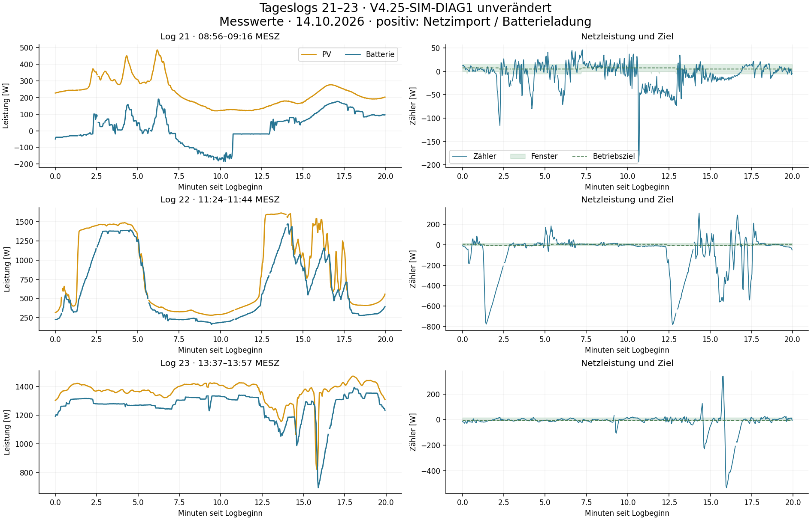

# Logs 21–23: unabhängige Prüfung, Modell V16 und Regleroptimierung

14.10.2026. **Modell V16 ergänzt; Regler bleibt V4.25-SIM-DIAG1.** Die drei neuen Logs wurden gegen die vorhandene Kennlinie geprüft. Zusätzlich wurden 16 Änderungen einschließlich modellgestützter Nachführung untersucht. Keine wird als neuer Anlagenstand übernommen: Verbesserungen der mittleren Zielabweichung gehen weiterhin mit mehr Import oder einzelnen schlechteren Folgereaktionen einher. Ein physikalisches Gesamtoptimum ist nicht bewiesen.

## Gemessene Ergebnisse

Laden: Fenster **−5…+15 W**, Ziel unter 720 W PV **+5 W**, bei High/Very High **−5 W**. Entladen: Fenster **0…+15 W**, Ziel **+7,5 W**. Die Fenster bleiben unverändert. Positiver Zählerwert bedeutet Import. Kennzahlen sind zeitgewichtet über benachbarte gültige Messzyklen; Diagnose-Abbrüche werden nicht als 0-W-Messungen verwendet.

| Abschnitt | PV | Mittlerer Zähler | Zielabweichung MAE | Zeit im Fenster |
|---|---:|---:|---:|---:|
| Log 21, Entladen | innerhalb 120–486 W | −9,32 W | 23,13 W | 42,05 % |
| Log 21, Laden | innerhalb 120–486 W | −4,09 W | 16,91 W | 45,15 % |
| Log 22, Normal-PV | unter 720 W | +3,45 W | 22,94 W | 47,67 % |
| Log 22, High-PV | 720–1.049 W | −80,17 W | 158,87 W | 2,94 % |
| Log 22, Very-High-PV | 1.050–1.615 W | −210,18 W | 233,95 W | 15,56 % |
| Log 23, Very-High-PV | 1.050–1.471 W | −18,88 W | 27,00 W | 50,34 % |

Die sechs zusätzlichen High-PV-Punkte in Log 23 sind ein kurzer dynamischer Abschnitt und keine belastbare ruhige Stichprobe. Log 22 erreicht insgesamt **−782…+311 W**, Log 23 **−533…+340 W**. Mittelwerte allein reichen deshalb zur Bewertung nicht aus. Bei schnellen PV-Sprüngen bestehen sowohl Export als auch Import außerhalb des Fensters.

Log 21 enthält drei Richtungswechsel: um 08:58:17,569 Entladen→Laden bei −103 W Zähler und 60 W erster Ladeanforderung; um 09:03:15,659 Laden→Entladen bei +35 W und 39 W erster Entladeanforderung; um 09:08:59,786 erneut Laden bei −62 W und 60 W Anforderung. Diese Fälle ergänzen den bekannten vorsichtigen Übergang bei schwacher PV. Der Sollwert allein beschreibt dabei noch nicht die wirksame Batterieleistung.

SOC: Log 21 konstant 77 %, Log 22 88–91 %, Log 23 92–96 %. Laden und Entladen sind freigegeben; `batt_min`/`batt_max` sind nicht aktiv. Aus diesen Logs wird keine neue Vollakku-Aufnahmegrenze abgeleitet.

## Datenqualität und Replay

**1.799 Aufrufe, 1.775 Regelberechnungen, 24 Snapshot-Abbrüche** (12/9/3). Aufrufsequenz und Logger-Eingangssequenz sind durchgehend. Keine doppelten Messzyklus-IDs in diesen drei Logs. Alle ausgeführten Stellbefehle, Ziele, Modi und Integratoren werden im vollständigen Replay exakt reproduziert; der Zustand bleibt über bekannte Abbrüche erhalten. Die Abbrüche behalten leere Ausgänge 1–3 und Diagnose an Ausgang 4.

Nach dem Neustart sind die Zykluszähler fünfstellig. Die kurze Anzeige enthält dadurch beispielsweise `-21231`: Der Bindestrich gehört zur abgeschnittenen ID, nicht zu einem negativen Zähler. Die Auswertung verwendet deshalb den numerischen Suffix der **vollständigen** Zyklus-ID. Dafür ist kein Logger- oder Reglerumbau nötig.

Die Schutzgrenzen werden nicht gelockert. Bei verworfenen Builder-Snapshots fehlen weiterhin die vollständigen abgelehnten Werte, um eine nachträgliche Zulassung zuverlässig zu simulieren.

## Modellkalibrierung und unabhängige Prüfung

Die eingefrorene V15-Tageskennlinie wurde nur an älteren Daten angepasst. Die neuen Logs sind deshalb unabhängige Prüfdaten für diese Kennlinie.

| Ladeabschnitt | Historisches Nominalmodell RMSE / MAE | V15-Tageskennlinie RMSE / MAE |
|---|---:|---:|
| Log 21 | 7,49 / 3,85 W | 7,00 / 3,23 W |
| Log 22 | 13,17 / 8,03 W | 11,81 / 7,05 W |
| Log 23 | 22,29 / 21,24 W | 17,39 / 16,25 W |

V15 bleibt die bessere lokale Tagesvariante. In Log 23 liegt die gemeldete Ladeleistung dennoch im Mittel **15,83 W über der Vorhersage**. Dieser Fehler ist relevant für einen Regler, der seinen neuen Sollwert auf die gemeldete Batterie-Istleistung aufsetzt.

Eine zusätzliche lokale Telemetrie-Korrektur wurde nur an den ersten zehn Minuten von Log 23 angepasst: **+16,95 W**. Im übrigen, nicht zum Fit verwendeten Abschnitt sinkt RMSE von **17,70 auf 9,72 W**, MAE von **15,70 auf 5,57 W**. Bei globaler Anwendung werden dagegen Logs 21 und 22 deutlich schlechter. V16 ergänzt deshalb einen **lokalen Telemetrieoffset als Unsicherheitsfall**, ohne die bisherige Kennlinie global zu ersetzen.

Dies beweist weder eine SOC-Kennlinie noch eine Änderung der realen AC-Leistung. SOC, Messpfad, Betriebszustand und zeitliche Zuordnung sind hier nicht unabhängig voneinander identifiziert. Abgeleitete Hausleistung ist kein unabhängiges Messgerät; einzelne negative Hauswerte sind insbesondere keine verifizierte negative Hauslast. Physikalischer Zählerpfad und Batterietelemetrie werden weiterhin getrennt als Unsicherheit behandelt. Aufnahmebegrenzung und voller Standby aus früheren Logs bleiben erhalten.

## Geprüfte Regleränderungen

**3.048 geschlossene Läufe:** 17 Fassungen einschließlich Basis, zwölf Anlagenvarianten, Logs 19–23 mit/ohne fest wiederverwendeten Batterie-Messrest = **2.040 Läufe**. Vier Fassungen werden anschließend an sieben synthetischen Störverläufen und älteren Logs 8/9/11/15/16/17/18 geprüft = **1.008 weitere Läufe**. Modellvarianten berücksichtigen verschiedene Zähler-/Batterieverzögerungen, nominale/Tageskennlinie und einen zusätzlichen Telemetrieoffset. Es laufen die vollständigen Function-Berechnungen mit simulierten Folgemessungen.

| Ansatz | Beobachtung | Entscheidung |
|---|---|---|
| Ausstehende Stellreaktionen aus der Befehlsfolge berücksichtigen; schnellere Rampe 30–60 W | Im Mittel bessere Zielabweichung; im Screening bis rund 260 W höhere Importspitze | Simulation-only, nicht übernehmen |
| Kleinere High-PV-Importverstärkung 0,9/0,7 statt 1,3 | Gemischte Fenstertreue, mehr Importenergie und teils höhere Spitzen | Nicht übernehmen |
| Kombination mit anderer Exportverstärkung/Trendvorhaltung | Kein durchgängiger Vorteil unter Importpriorität | Nicht übernehmen |
| Ruhigen kleinen Import vom letzten Sollwert aus um 1 W absenken, 6 s warten | Kleine mittlere Importverbesserung; keine höhere globale Importspitze in den geprüften Fällen, aber einzelne Abschnitte mit mehr Importenergie und schlechterer Zielabweichung | Nutzen zu klein und uneinheitlich für eine Empfehlung |
| 3/5-W-Korrektur | Etwas mehr Wirkung auf ruhigen Import, aber zusätzliche Spitzen und tiefere Exportlage | Nicht übernehmen |
| Strengere Freigabe nach 8/10 s und bestätigter Stabilität | Wirkung ebenfalls klein; die abschließend geprüfte 8-s-Variante erhöht eine Importspitze im Screening um rund 11 W | Nicht übernehmen |

Die modellgestützte Nachführung zeigt Potenzial, erfüllt aber die gewünschte Priorität „High-PV-Import möglichst zuverlässig vermeiden“ noch nicht besser. Eine ruhigere, kleine Korrektur ist technisch möglich; ihr Vorteil liegt hier jedoch weit unter den Auswirkungen der großen PV-Sprünge und ist nicht durchgehend vorhanden. Es wäre irreführend, daraus eine generell verbesserte V4.26 zu erklären.

Die Varianten mit modellgestützter Nachführung sind Forschungsprototypen. Sie sind kein Node-RED-Import zur Installation und enthalten keine live validierte neue Reglerfassung. Alle Low-/Normal-PV-Ausgänge der Referenzlogs 15–18 und 21 bleiben in den entsprechenden Gleichheitsprüfungen erhalten. Die Fehler- und Diagnosebehandlung des aktuellen Reglers wird durch diese Veröffentlichung nicht verändert.

## Grenzen und nächster Schritt

Die Baseline wird mit rekonstruiertem Nettoleistungsverlauf und wiederverwendetem Messrest teilweise exakt zurückgewonnen. Das ist ein Konsistenztest, keine unabhängige Zukunftsprognose. Die ergänzenden Läufe ohne Messrest und mit eigenständigen Störsignalen prüfen Robustheit, beseitigen aber nicht die Unsicherheit des realen Zähler-/Batteriepfads. Im Replay werden protokollierte interne Trim-Zeitpunkte verwendet; die geschlossene Simulation verwendet virtuelle Zeit.

**V4.25-SIM-DIAG1 bleibt der Anlagenstand. Kein Function-Code muss ersetzt werden.** Das physikalische Optimum ist nicht belegt. Der nächste größere Fortschritt benötigt eine bessere Trennung von tatsächlicher AC-Stellreaktion und Batterietelemetrie, insbesondere des in Log 23 beobachteten Offsets. Eine unabhängige AC-Leistungsmessung am SolarFlow beziehungsweise geräteseitige Empfangszeitpunkte wären dafür aussagekräftiger als ein weiterer pauschaler Gain- oder Rampenanstieg.
